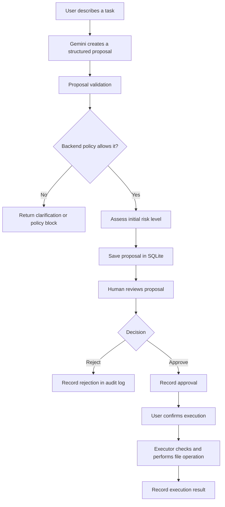

<div align="center">

# Agent Oversight Workbench

### A human-in-the-loop control layer for AI agent actions

Review proposed actions, enforce workspace policies, assess operational risk, and keep an auditable record before an agent changes files.

[](https://www.python.org/)
[](https://fastapi.tiangolo.com/)
[](https://react.dev/)
[](https://www.typescriptlang.org/)
[](#project-status)

[Overview](#overview) · [Features](#current-capabilities) · [Architecture](#how-it-works) · [Setup](#getting-started) · [Tests](#running-tests) · [Roadmap](#roadmap)

</div>

---

## Overview

AI agents can take actions through tools and external services. Those actions may change files, move information, or affect resources a user cares about. Agent Oversight Workbench is being built as a control point between an AI agent and the actions it proposes.

The current prototype accepts a natural-language instruction, uses Gemini to turn it into a structured file-operation proposal, checks the proposal against deterministic backend policies, assigns an initial risk level, and places permitted actions in a human approval queue. An approved action can then be executed inside a dedicated local workspace. Decisions and execution results are recorded in SQLite.

**The project is currently a local development prototype.** Cloud authentication and multi-user support are under development; the backend is not yet ready for public or production use.

## Current capabilities

| Capability | Current implementation |
|---|---|
| AI action proposals | Gemini converts a user's instruction into a structured proposal. |
| Supported operations | Copy, move, and rename files. |
| Policy checks | Backend rules validate supported operations and workspace paths before an action enters the queue. |
| Workspace boundaries | Path validation rejects unsafe paths, including attempts to escape the dedicated workspace. |
| Risk assessment | Initial rule-based classification: copy = low; move and rename = medium. |
| Human approval | Users can approve or reject proposals before execution. |
| Execution confirmation | Approved file operations require a separate confirmation step. |
| Execution tracking | Actions record not-started, running, completed, or failed execution states. |
| Audit history | Approval/rejection decisions and execution outcomes are stored in SQLite. |
| Duplicate prevention | Identical pending or approved-but-not-yet-executed proposals are checked before insertion. |

Risk levels are currently simple operation-based labels, not a comprehensive assessment of data sensitivity, impact, scope, or reversibility. All permitted actions still require human approval. A risk label does not override a policy restriction.

## How it works



### Main components

- **React + TypeScript frontend** — dashboard, proposal form, approval queue, risk details, decision history, and execution history.
- **FastAPI backend** — API endpoints and orchestration of proposal, policy, risk, approval, and execution flows.
- **AI service** — uses the Google GenAI SDK to generate structured proposals from user instructions and workspace inventory.
- **Policy engine** — makes deterministic allow/block decisions independently of the AI model.
- **Workspace path validation and executor** — constrain file operations to the dedicated workspace and perform supported operations.
- **Risk assessment module** — assigns an initial risk level and human-review recommendation based on the operation type.
- **SQLite** — persists actions, approval decisions, and execution history in the local prototype.

## Technology stack

| Layer | Technology |
|---|---|
| Frontend | React, TypeScript, Vite |
| Backend | Python, FastAPI, Pydantic, Uvicorn |
| AI proposal generation | Google GenAI SDK (Gemini) |
| Policy and execution | Python modules with workspace path validation |
| Local persistence | SQLite |
| Testing | pytest |
| Cloud authentication work in progress | Supabase Auth (frontend integration in progress) |

## Getting started

These instructions run the current local prototype on your machine. They are not cloud deployment instructions.

### Prerequisites

- Python 3.13 or a compatible Python version supported by the dependencies
- Node.js 22 or a compatible version for the installed Vite toolchain
- npm
- A Gemini API key from [Google AI Studio](https://aistudio.google.com/)
- Supabase project credentials for the authentication work currently being integrated

### 1. Clone the repository

```bash
git clone https://github.com/pantpujan017/agent-oversight-workbench.git
cd agent-oversight-workbench
```

### 2. Set up the backend

```powershell
cd backend
python -m venv .venv
.\.venv\Scripts\Activate.ps1
python -m pip install -r requirements-dev.txt
```

Create `backend/.env`:

```dotenv
GEMINI_API_KEY=your_gemini_api_key
# Optional: defaults to the model configured in ai_service.py
GEMINI_MODEL=gemini-3.5-flash-lite
```

Keep this file private. Do not commit API keys or other secrets.

Start the backend from the `backend` directory:

```powershell
python -m uvicorn main:app --reload --host 127.0.0.1 --port 8000
```

The API health endpoint is available at `http://127.0.0.1:8000/health`, and the interactive API documentation is at `http://127.0.0.1:8000/docs`.

### 3. Set up the frontend

Open a second terminal:

```powershell
cd frontend
npm install
```

Create `frontend/.env.local` with your own local values:

```dotenv
VITE_API_URL=http://127.0.0.1:8000
VITE_SUPABASE_URL=https://YOUR_PROJECT_REF.supabase.co
VITE_SUPABASE_PUBLISHABLE_KEY=your_supabase_publishable_key
```

The Supabase variables are used by the frontend authentication integration. Use only the Supabase publishable key in browser code. Never put a Supabase secret/service-role key in a `VITE_` variable or frontend source code.

Start the frontend:

```powershell
npm run dev
```

Open `http://localhost:5173` in your browser.

> **Authentication status:** The Supabase registration/login interface and frontend session integration are being developed. FastAPI JWT verification, per-user authorization, and per-user workspace/data isolation must be completed before this application is exposed to public users.

## Running tests

From the `backend` directory, with the virtual environment activated:

```powershell
python -m pytest -v -rs
```

The latest recorded full-suite result during development is **49 passed**. Run the command locally to verify the current checkout; test totals may change as the project evolves.

To run the frontend production build, from `frontend`:

```powershell
npm run build
```

## API overview

The current local backend exposes these main routes:

| Method | Route | Purpose |
|---|---|---|
| `GET` | `/health` | Backend health check. |
| `GET` | `/actions` | Retrieve action proposals and their states. |
| `POST` | `/proposals` | Generate and queue an AI action proposal. |
| `POST` | `/actions/{action_id}/decision` | Approve or reject a pending action. |
| `POST` | `/actions/{action_id}/execute` | Execute an approved action after confirmation. |
| `GET` | `/audit-log` | Retrieve approval/rejection history. |
| `GET` | `/execution-log` | Retrieve file execution history. |

The routes above describe the current prototype API. Backend authentication and user-level access control are not yet complete; do not treat these endpoints as protected in a public deployment.

## Project structure

```text
agent-oversight-workbench/
├── backend/
│   ├── agent_workspace/          # Local sandbox workspace for file operations
│   ├── tests/                    # Automated backend tests
│   ├── ai_service.py             # Gemini proposal generation and validation
│   ├── executor.py               # Supported file operations
│   ├── main.py                   # FastAPI app, routes, and SQLite persistence
│   ├── policy.py                 # Deterministic action policy checks
│   ├── risk_assessment.py        # Initial operation-based risk classification
│   ├── workspace_paths.py        # Workspace path validation
│   ├── requirements.txt          # Runtime Python dependencies
│   └── requirements-dev.txt      # Runtime and development dependencies
├── frontend/
│   ├── src/
│   │   ├── lib/                  # Shared frontend clients
│   │   ├── App.tsx               # Main dashboard
│   │   └── Auth.tsx              # Registration/login interface
│   ├── package.json
│   └── .env.local                # Local frontend configuration (not committed)
└── README.md
```

Local databases, virtual environments, API credentials, and user-specific configuration should remain out of version control.

## Security and current limitations

This project is actively developed and should be treated as a **local prototype**, not a production security boundary.

Before a public/cloud release, the following work is required:

- Verify Supabase access tokens in FastAPI on every protected request.
- Enforce ownership checks for actions, audit records, and execution records.
- Give each user an isolated workspace and prevent cross-user file access.
- Replace or migrate local SQLite persistence to a cloud-ready database such as PostgreSQL.
- Configure production CORS, secrets management, email delivery, rate limits, and secure deployment settings.
- Add robust execution recovery, concurrency controls, and operational monitoring.
- Review the executor's filesystem boundary and threat model before handling real user data.

The current prototype uses a local SQLite database and a dedicated local workspace under `backend/agent_workspace`. Do not use it to process sensitive or production data.

## Roadmap

- [x] Gemini-based structured action proposals
- [x] Deterministic policy checks for supported file operations
- [x] Workspace path validation
- [x] Human approval and rejection workflow
- [x] Controlled local file execution
- [x] Decision and execution history
- [x] Initial risk classification and dashboard display
- [x] Automated backend test suite (49 passed in the latest recorded run)
- [ ] Complete Supabase registration, login, and session handling
- [ ] Verify JWTs in FastAPI and enforce per-user authorization
- [ ] Isolate user data and workspaces
- [ ] Migrate persistence to a managed cloud database
- [ ] Add configurable policies and richer risk factors
- [ ] Add integrations for external tools and services
- [ ] Deploy and harden the cloud SaaS application

## Contributing

Issues and focused pull requests are welcome. Before opening a pull request:

1. Explain the problem or proposed improvement.
2. Keep security-sensitive changes narrowly scoped and documented.
3. Add or update tests for changed behaviour.
4. Run the backend test suite and frontend production build.
5. Never include `.env` files, API keys, service-role keys, databases, or virtual environments.

## License

A license has not yet been specified for this repository. Until a license is added, do not assume that the code is available for reuse, redistribution, or commercial use.

---

<div align="center">

Built to make AI agent actions more visible, reviewable, and controllable.

</div>
